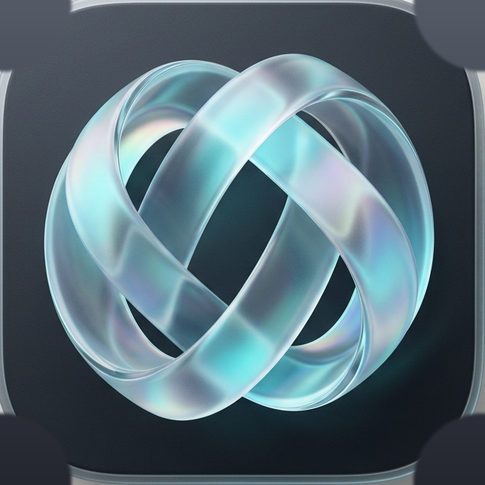

# 🌌 Convx — Audiophile iOS Music Experience

<p align="center">
  
</p>

<p align="center">
  <b>Una experiencia musical pura, ultra fluida y sensorial para iOS</b><br>
  Diseñada con SwiftUI nativo, vidrio translúcido Liquid Glass (visionOS aesthetic), streaming sin anuncios sin estrangulamiento y reproducción sin conexión instantánea.
</p>

---

## ✨ Características Principales

### 🎨 1. Sistema Sensorial UX/UI & Liquid Glass
- **Notch Island Adaptativa (iPhone 16e y dispositivos con Notch):** Transforma la muesca de hardware en una isla interactiva. Muestra la portada, título y ecualizador animado en modo compacto justo debajo del notch, y se expande con un toque o gesto hacia abajo en un reproductor rápido con scrubber y controles táctiles.
- **Lienzo Reactivo a la Carátula (Dynamic Sonic Canvas):** Fondo de malla animado (*MeshGradientBackground*) que respira y se sincroniza armónicamente con la paleta de colores de la canción actual.
- **Píldora HUD Flotante (Dynamic Island Style):** Cápsula de micro-retroalimentación háptica y visual que desciende desde la parte superior para confirmar acciones clave (*"Agregado a Favoritos"*, *"Reproducir a continuación"*, *"Descargando álbum..."*).
- **Gesto Ergonómico Swipe-to-Queue:** Desliza cualquier canción en búsquedas, listas o perfiles hacia la derecha para encolarla como siguiente pista con respuesta táctil rígida.
- **MiniPlayer con Micro Barra Luminosa:** Línea de progreso de neón de 2.2pt con gradiente reactivo y mini ecualizador en vivo de 3 bandas.
- **Tactile Scrubber con Lupa:** Control de reproducción milimétrico con ticks hápticos cada 30 segundos y burbuja temporal flotante.
- **Skeletons Shimmer de Vidrio Líquido:** Transiciones de carga suaves sin caídas de cuadros.

### ⚡ 2. Motor de Audio de Latencia Cero (<50ms)
- **Pipeline de Audio Unthrottled:** Peticiones directas a la API interna de YouTube Music con bypass de compresión y CDN de JioSaavn para audio sin anuncios.
- **Prefetching Predictivo:** Precarga en segundo plano de las 2 siguientes pistas de la cola hacia la memoria intermedia y caché local, permitiendo saltos de canción instantáneos.
- **Mitigación de Artefactos de Duración:** Algoritmo que detecta y corrige discrepancias de timescale de CoreMedia en streams fMP4 / itag 140 AAC.

### 📥 3. Modo Desconectado Atómico (Offline First)
- **Descargas de 1 Toque:** Motor de descarga concurrente con escritura atómica en almacenamiento persistente (`.m4a`).
- **Descarga por Lote:** Botón maestro en álbumes y listas con indicador de progreso circular en tiempo real.
- **Buscador Rápido Offline:** Filtrado en vivo sobre canciones descargadas con carátulas en caché RAM de 120 FPS.

### 🎛️ 4. Gestión Avanzada de Cola & Armonía Musical
- **Reordenamiento Táctil:** Arrastra y suelta pistas en la cola en vivo.
- **Modo Camelot Harmonic Flow:** Algoritmo inteligente que analiza y reordena la cola para una transición armónica continua entre tonalidades y energías musicales.
- **AutoMix Infinito:** Detección de agotamiento de cola con reposición automática basada en similitud de artistas y tempo.

### 💿 5. Modos de Reproducción en Escenario
- **Carátula Moderna con Respiración (Breathing Artwork):** Portada reactiva con aura luminosa dinámica.
- **Vinilo Retro LP (33 RPM):** Disco de vinilo realista con textura anisotrópica reflectante a 45°, surcos físicos y desaceleración por inercia realista.
- **Visualizador Minimalista:** 26 bandas de frecuencia reactivas con diseño audiófilo.
- **Letras Sincronizadas:** Letras tiempo real palabra por palabra.

---

## 🏛️ Arquitectura del Proyecto

```
Convx/
├── Package.swift                       # Swift Package Manager Manifest
├── xtool.yml                           # Toolchain de compilación para iOS
├── instalar.ps1                        # Pipeline de compilación y despliegue a dispositivo
├── Sources/
│   └── Convx/
│       ├── ConvxApp.swift              # Punto de entrada de la aplicación iOS
│       ├── ContentView.swift           # Contenedor raíz con pestañas persistentes
│       ├── Models/
│       │   ├── SongItem.swift          # Entidades canónicas de canción y metadatos
│       │   ├── DownloadedSong.swift    # Estructura de almacenamiento offline
│       │   └── UserPlaylist.swift      # Listas locales creadas por el usuario
│       ├── Services/
│       │   ├── AudioPlayerService.swift# Motor de streaming AVPlayer, prefetching y ecualizador
│       │   ├── DownloadService.swift   # Gestor de descargas atómicas y concurrencia
│       │   ├── HUDService.swift        # Servicio Dynamic Island HUD global
│       │   ├── InnerTubeService.swift  # Cliente de endpoints nativos y búsqueda canónica
│       │   ├── LikedSongsService.swift # Gestión de favoritos y sincronización NowPlaying
│       │   ├── RecommendationService.swift # Algoritmo de AutoMix y recomendaciones
│       │   └── ThemeManager.swift      # Paleta de acentos y estilos de escenario
│       ├── Components/
│       │   ├── LiquidGlass.swift       # Sistema de materiales esmerilados y caché RAM 120 FPS
│       │   ├── ConvxMicroInteractions.swift # HUD, SwipeableSongRow, Vinilo y Scrubber táctil
│       │   ├── BatchDownloadButton.swift # Botón maestro de descarga por lote
│       │   └── DownloadButton.swift    # Botón contextual de descarga individual
│       └── Views/
│           ├── HomeView.swift          # Feed inteligente con carruseles y skeletons
│           ├── SearchView.swift        # Búsqueda con tarjeta Hero de artista oficial
│           ├── PlayerView.swift        # Reproductor inmersivo a pantalla completa
│           ├── MiniPlayerView.swift    # Mini reproductor flotante con micro barra
│           ├── QueueView.swift         # Cola interactiva con ordenamiento Camelot
│           ├── ArtistDetailView.swift  # Perfil canónico de artista y discografía
│           ├── AlbumDetailView.swift   # Detalle de álbum con descarga 1-tap
│           ├── DownloadsView.swift     # Biblioteca offline con filtro instantáneo
│           └── SettingsView.swift      # Preferencias de audio y mezcla armónica
```

---

## 🚀 Despliegue en Dispositivo Físico

El proyecto está optimizado para compilarse y desplegarse en dispositivos iOS físicos (por ejemplo, iPhone 15 Pro):

1. Conecta tu iPhone por USB y asegúrate de confiar en el equipo.
2. Inicia el túnel de usbmuxd:
   ```powershell
   python usbmuxd_proxy.py
   ```
3. Compila e instala con un solo comando:
   ```powershell
   powershell -ExecutionPolicy Bypass -File .\instalar.ps1
   ```

---

## 📜 Licencia y Créditos

Desarrollado con pasión por **Eduardo Aguilar** ([@edagrex-sketch](https://github.com/edagrex-sketch)).
Inspirado en la filosofía de diseño sensorial de Apple Human Interface Guidelines y visionOS.
